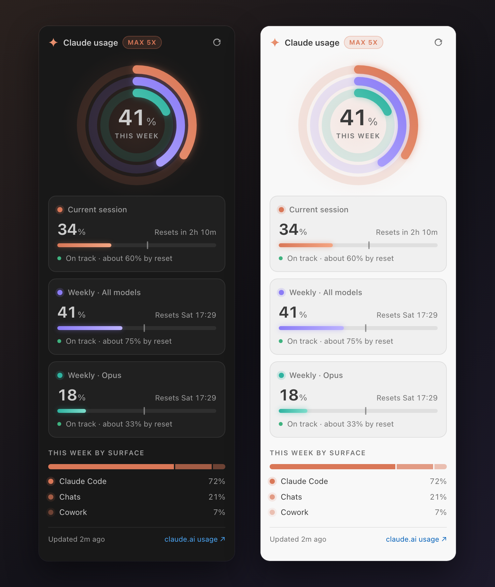
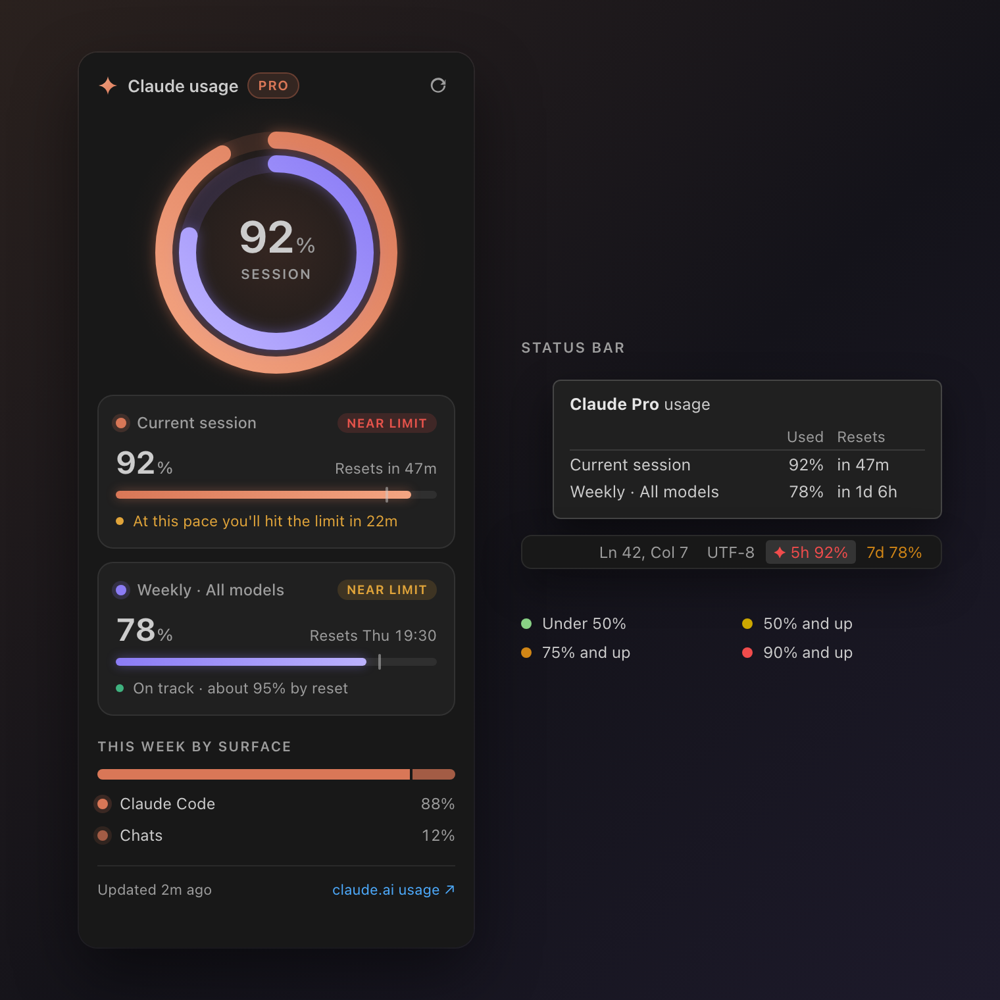

# Claude Quota

See your Claude plan usage limits without leaving VS Code.

> **Unofficial.** This is an independent project. It is not affiliated with, endorsed by, or sponsored by Anthropic.





<sub>Screenshots use sample data.</sub>

- **Sidebar dashboard**: rings for your session and weekly limits, a card per limit with its reset countdown, a pace marker showing how much of the window has passed, and a projection of whether you'll hit the limit before it resets.
- **Breakdown** of where this week's usage went (Claude Code, chats, and so on).
- **Status bar** values for your session and weekly limits (`5h 12%` `7d 40%`), each colored by how much is used: green under 50%, yellow from 50%, orange from 75%, red from 90%. Click either one to open or close the dashboard.

## How it works

The extension reads the sign-in that Claude Code already stores on your machine (the macOS Keychain, or `~/.claude/.credentials.json` on Linux and Windows) and calls the same usage endpoint that Claude Code's `/usage` command reads. It never writes or refreshes your credentials. If the token has expired, run Claude Code once and it will refresh it.

## Settings

| Setting | Default | |
|:--|:--|:--|
| `claudeQuota.refreshIntervalMinutes` | `5` | How often to refresh. |
| `claudeQuota.showInStatusBar` | `true` | Show the status bar item. |

All open VS Code windows share one cached result, so together they make about one request per interval. The refresh button fetches again at most once a minute. If Claude rate-limits the check, the extension keeps showing the last numbers and waits 2, 5, 10, then 15 minutes before retrying.

## Colors

The status bar colors follow your theme. While you're debugging or have no folder open, VS Code gives the status bar a different background, and in high-contrast themes the colors would hurt readability. In those cases the values use the status bar's own text color, and usage from 75% or 90% gets VS Code's warning or error highlight instead.

If your theme uses a colored status bar and the values are hard to read, override the colors in your settings:

```json
"workbench.colorCustomizations": {
  "claudeQuota.statusBar.low": "#b5f5c8",
  "claudeQuota.statusBar.medium": "#ffe9a0",
  "claudeQuota.statusBar.high": "#ffc28a",
  "claudeQuota.statusBar.critical": "#ffb0a8"
}
```

## License

[MIT](LICENSE)

Claude and Anthropic are trademarks of Anthropic, PBC. They are used here only to describe what the extension works with.
